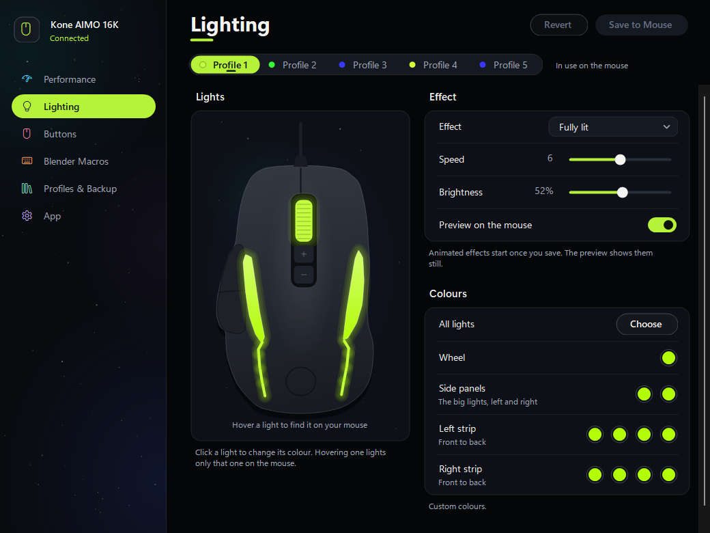

# Unofficial Kone AIMO Config

A Windows settings app for the ROCCAT Kone AIMO Remastered (16K sensor). ROCCAT was retired as a brand in 2024, and I made this to keep configuring my own mouse.

**Unofficial:** not made, endorsed or supported by Turtle Beach or ROCCAT.



## Made for my setup

I'm a 3D animator and built this around how I work, so it has a Blender page: one-click shortcuts plus a few multi-step macros (reset pose, mirror pose, key everything). If you don't use Blender, skip that page. The rest is a normal mouse settings app.

## What it does

- DPI stages, polling rate, sensitivity and angle snapping
- Lighting effect, speed, brightness and the colour of all 11 LEDs, previewed live on the mouse
- Every button on both the normal and the Easy-Shift layer: clicks, media keys, keyboard shortcuts
- All 5 profiles, JSON backups, and a check at login that the mouse still has what you last saved

Settings are stored in the mouse itself, so they work on any PC without the app. Only the multi-step Blender macros need it running.

## Install

1. Download `UnofficialKoneAimoConfig-Setup-<version>.exe` from [Releases](../../releases).
2. Run it. The app isn't code-signed, so Windows may say "Windows protected your PC". Click **More info**, then **Run anyway**.
3. Choose **Install** (adds a Start menu entry; uninstall from Settings > Apps) or **Just run it**.

No admin rights needed. You need Windows 10 or 11 (64-bit) and a Kone AIMO Remastered (USB ID `1E7D:2E2C`). Other models, including the original Kone AIMO, aren't supported. Close ROCCAT Swarm first if it's installed.

## Is it safe for the mouse?

- It changes the same stored settings the official software did. It never touches the firmware.
- Every save is read back from the mouse and checked.
- The first time it connects, it saves a copy of your mouse's settings to `%APPDATA%\KoneAimoConfig\original_settings.json`. You can restore it from Profiles & Backup.

## Build

Needs the .NET SDK. The app targets .NET Framework 4.8, which ships with Windows 10 and 11.

```
dotnet build KoneAimoConfig -c Release
```

The exe ends up in `KoneAimoConfig/bin/Release/net48/`. It is also the installer.

## Legal

- ROCCAT, Kone, AIMO and Easy-Shift are trademarks of Turtle Beach Corporation or its affiliates. They're used here only to say which mouse this works with. Blender is a trademark of the Blender Foundation.
- No Turtle Beach or ROCCAT code is included, and none was decompiled. The USB protocol comes from open-source projects (libratbag, OpenRGB) and from testing my own mouse.
- Provided as is, without warranty (see [LICENSE](LICENSE)). Turtle Beach's warranty doesn't cover damage caused by software it doesn't provide.

Made by Miguel Valencia, with help from Claude.
